<a href="https://iamnoorkhan.com">
  <picture>
    <source media="(prefers-color-scheme: dark)" srcset="assets/banner-dark.svg">
    
  </picture>
</a>

  
  
  
  

### Hi, I'm Noor 👋

I'm a **Semantic SEO and AI search strategist** with a software engineering background. I help brands become the source that Google, ChatGPT, Perplexity and AI Overviews trust, cite and recommend, through entity-first content, topical authority and clean technical SEO.

- 🧭 **Now:** leading semantic SEO, GEO and AEO strategy, and writing about AI search at [iamnoorkhan.com](https://iamnoorkhan.com/blog)
- 🎙️ **Hosting:** the [Noor Khan Podcast](https://iamnoorkhan.com/podcast), conversations with SEO and AI search practitioners
- 🎓 **Studying:** MSc Computer Science · Semantic SEO certified (Koray Tuğberk GÜBÜR)
- 💼 **Open to:** senior SEO, SEO lead and AI search roles, fully remote (GMT+5)

### 📈 Selected results

| <h3>+300%</h3>organic conversions Olympic Behavioral Health | <h3>+250%</h3>organic traffic Grove Healthcare | <h3>+180%</h3>qualified leads Addiction recovery centers | <h3>650+</h3>semantic content briefs Automotive and healthcare |
|:---:|:---:|:---:|:---:|

### 🧠 What I do

| Focus | What that means for you |
|---|---|
| **Semantic SEO strategy** | Entity research, topical maps and content briefs that writers can execute from directly |
| **AI search (GEO & AEO)** | Structuring content and brand signals so AI assistants find, understand and cite you |
| **Technical SEO** | Crawlability, indexation, site architecture, internal linking, schema (JSON-LD), Core Web Vitals |
| **SEO-first web development** | Fast, accessible sites built from a topical map, like [the one I built for myself](https://iamnoorkhan.com) |

### ✍️ Latest writing

<!-- BLOG-POST-LIST:START -->
- [Top 100 SEO Experts in the World (2026)](https://iamnoorkhan.com/blog/top-seo-experts)
- [ChatGPT Has Wrong Information About My Business: How to Fix It](https://iamnoorkhan.com/blog/chatgpt-wrong-information-about-business)
- [AI Crawlers and robots.txt: Which Bots to Allow or Block in 2026](https://iamnoorkhan.com/blog/ai-crawlers-robots-txt)
- [How to Get Cited in Google AI Overviews and AI Mode](https://iamnoorkhan.com/blog/how-to-get-cited-in-google-ai-overviews)
- [AI Search Optimization: How to Get Found, Cited and Recommended by AI](https://iamnoorkhan.com/blog/ai-search-optimization-guide)
<!-- BLOG-POST-LIST:END -->

➡️ [All articles](https://iamnoorkhan.com/blog) · [SEO & AI search glossary](https://iamnoorkhan.com/glossary)

### 🛠️ Toolkit

  
  
  
  
  
  
  
  
  
  
  
  
  

---

  💬 Need a second opinion on your site? I send a free written <a href="https://iamnoorkhan.com/contact">SEO gap snapshot</a>, no call needed.

